<div align="center">


# Infinite Resume for Claude

**Create a free resume in Claude. Send it securely to Infinite Resume.<br>Pick from 50+ templates, edit as much as you like and download the PDF.**

[Documentation](https://www.infiniteresume.com/ai-resume-plugin) · [Install](#install) · [Create a resume](#create-a-resume) · [Update a resume](#update-a-resume) · [Security and privacy](#security-and-privacy)

</div>



## Why Infinite Resume for Claude

| Feature | What you get |
| --- | --- |
| ✍️ **Truthful writing** | Claude asks one useful question at a time and writes only what is true of your experience. It never invents employers, dates, metrics or qualifications. |
| 🎯 **Tailored to the job** | Paste a job posting and Claude matches it against experience you actually have, keeping any gaps out of your resume. |
| 🔎 **ATS readability** | A review of what applicant tracking systems read, with the few edits that matter most. |
| 🔐 **Secure handoff** | Nothing leaves the chat until you approve the complete draft. It then travels over a one-time link that opens only for your account. |
| 🎨 **50+ templates, all free** | Every template, font and colour on Infinite Resume is free. Change the design whenever you like. |
| ♾️ **Unlimited edits and downloads** | Unlimited resumes and edits, and unlimited watermark-free PDF downloads. |

## How it works

1. **Install the plugin** in Claude Code, Claude or Cowork ([see below](#install)).
2. **Ask Claude for a resume.** Start from scratch, paste your current one, or attach a file. Claude guides you one question at a time.
3. **Review the complete draft.** Claude shows the whole resume, and you change anything you like.
4. **Approve sending it.** Claude sends the approved resume to Infinite Resume and gives you a one-time link.
5. **Open the link** in a browser signed in to the same Infinite Resume account you connected. The resume opens in the editor.
6. **Design and download.** Pick a template, adjust fonts, colours and spacing, and download your PDF.

## Install

### Claude Code

In your terminal:

```sh
claude plugin marketplace add sattyapatil/infinite-resume-claude-plugin
claude plugin install infinite-resume@infinite-resume-marketplace
```

Or inside a Claude Code session: `/plugin marketplace add sattyapatil/infinite-resume-claude-plugin`, then `/plugin install infinite-resume@infinite-resume-marketplace`.

### Claude and Cowork

1. In Claude, open **Customize › Plugins › Add › Add marketplace** and enter `https://github.com/sattyapatil/infinite-resume-claude-plugin`.
2. Add **Infinite Resume**.
3. Open the plugin's **Connectors** tab and connect **Infinite Resume**.

## Connect your Infinite Resume account

The first time Claude uses the plugin's resume tools it opens a sign-in page on infiniteresume.com. Sign in with Google and choose **Allow connection**. Creating an account is free. Claude never sees your password. The permission covers only creating and replacing resume previews: the plugin has no tool that reads your saved resumes.

In Claude Code you can also connect beforehand: type `/mcp`, choose **infinite-resume** and sign in.

## Create a resume

Ask in your own words. For example:

> Build my resume for an entry-level data analyst role. Ask me one question at a time.

> Here is my current resume. Improve it without adding anything that isn't true.

> Tailor my resume to this job posting: …

Claude drafts each section from what you tell it and asks about anything missing. When the draft is ready, it shows you the complete resume and asks before sending anything. Say **"Send this to Infinite Resume"** to get your link.

## Update a resume

- **Before you open the link:** ask Claude for changes, review the new draft, and approve sending it again. Claude replaces the preview, and the earlier link stops working.
- **After you open the link:** your resume is saved in your Infinite Resume account. Make further edits there, with any template, as often as you like.
- **Starting over:** ask Claude to improve or tailor the resume again and send it. A new preview creates a separate resume, so your earlier version stays in your account.

## Open your preview

The plugin returns a one-time link that expires 45 minutes after it is created. Open it in a browser signed in to the same Infinite Resume account you connected. A link opens only for that account: signed out, you are asked to sign in, and a different account is refused without using the link up.

## Security and privacy

- **You decide what is sent.** Only the resume you approve is sent, and only when you approve it. Your conversation is not sent.
- **Narrow permission.** The connection can create and replace resume previews, nothing else.
- **One-time links.** Each link works once, expires after 45 minutes and opens only for the account that created it.
- **Optional contact details.** Leave your email and phone out and add them in the editor if you prefer.

Read the [privacy policy](https://www.infiniteresume.com/privacy-policy) and [terms](https://www.infiniteresume.com/terms).

## Support

Full documentation is at [infiniteresume.com/ai-resume-plugin](https://www.infiniteresume.com/ai-resume-plugin). For help, contact us at [infiniteresume.com/contact](https://www.infiniteresume.com/contact).

## License

The files in this repository (the skill, its reference guides and the manifests) are released under the [MIT License](LICENSE). The license does not grant rights to the Infinite Resume name or logo, or to the Infinite Resume website and service that the connection reaches.
